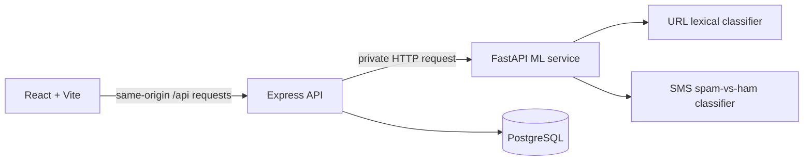

# Architecture

## Services

1. **React + Vite** serves the user interface and calls only the Express API.
2. **Express** owns input validation, cookie-based sessions, rate limiting, scan persistence, access checks, and API responses.
3. **FastAPI** loads the fitted scikit-learn pipelines at startup, extracts URL-only features, and returns model results with limitations.
4. **PostgreSQL + Drizzle** stores accounts, scan metadata/results, and feedback. Message bodies are not stored; saved URL previews omit paths, user info, query strings, and fragments.

Submitted URLs are parsed as strings only. No component performs DNS resolution, HTTP requests, redirects, or page rendering for a user-supplied URL.

The URL inference layer applies an evidence guard: a model score above the high-risk threshold is reported as `uncertain` with a 50/100 midpoint score when no concrete structural warning indicator is present. This avoids presenting source-specific training patterns as decisive evidence on a generic URL.

## Scan flow

1. The browser sends a URL or message to the versioned `/api` surface.
2. Express validates size and shape, then asks FastAPI for an assessment.
3. FastAPI extracts features or applies the fitted TF-IDF pipeline. The combined endpoint extracts at most ten links and runs each through the same URL feature contract.
4. Express validates the ML response against the generated Zod response schema.
5. Signed-in scans are persisted with the user's ID. Guest scans return a result but are not saved.
6. Dashboard counts and trends are computed from the signed-in user's stored scans for the requested time range.

## Combined assessment policy

- URL and text scores are never averaged and are not treated as statistically independent.
- Any high-risk URL controls the combined verdict.
- An uncertain URL result is preserved by the combined policy rather than silently discarded.
- A spam-like text result accompanied only by lower-risk URL results is `uncertain`.
- Other strong disagreement is `uncertain`; agreement follows the strongest relevant signal.
- Each URL result remains visible as separate evidence.
- This policy is documented as an educational heuristic and is not claimed to be validated on a labeled combined-message test set.

## Database model

- `scamshield_users`: normalized unique email, name, password hash, creation timestamp.
- `scamshield_scans`: optional owner, input type, verdict, score, indicators, recommendations, per-URL assessments, model version, limitations, redacted preview, creation timestamp.
- `scamshield_feedback`: owner, scan reference, feedback category, creation timestamp.

Sessions use a signed, time-limited token in an `HttpOnly`, `SameSite=Lax` cookie. User-specific reads and deletes include an owner filter; an unowned scan is returned as not found.
